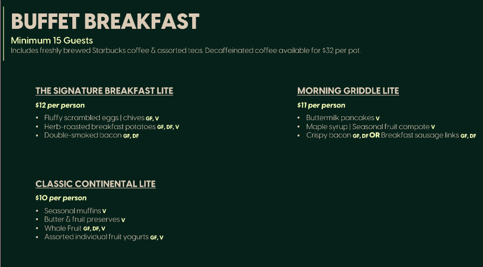
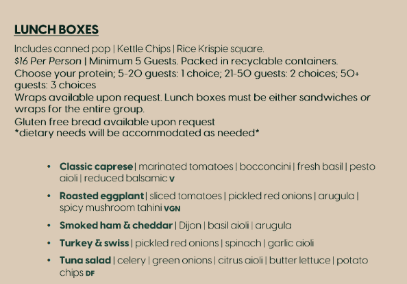
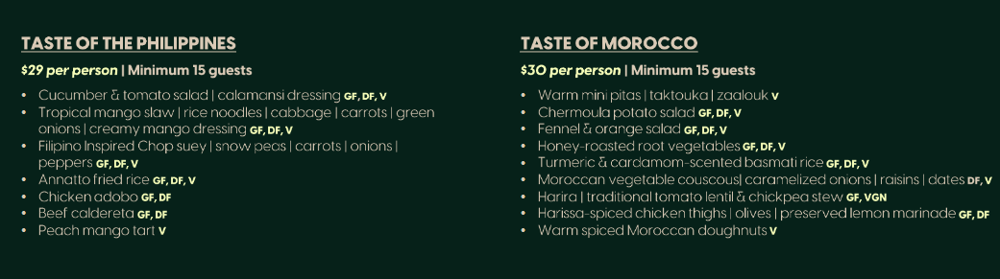
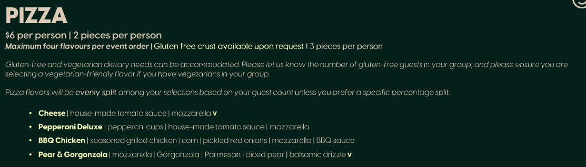
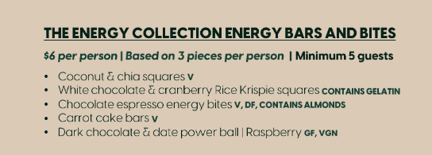
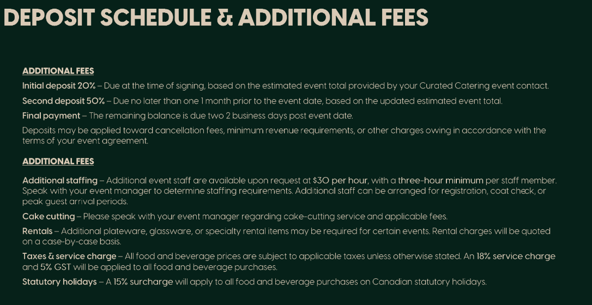
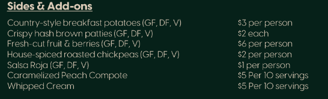
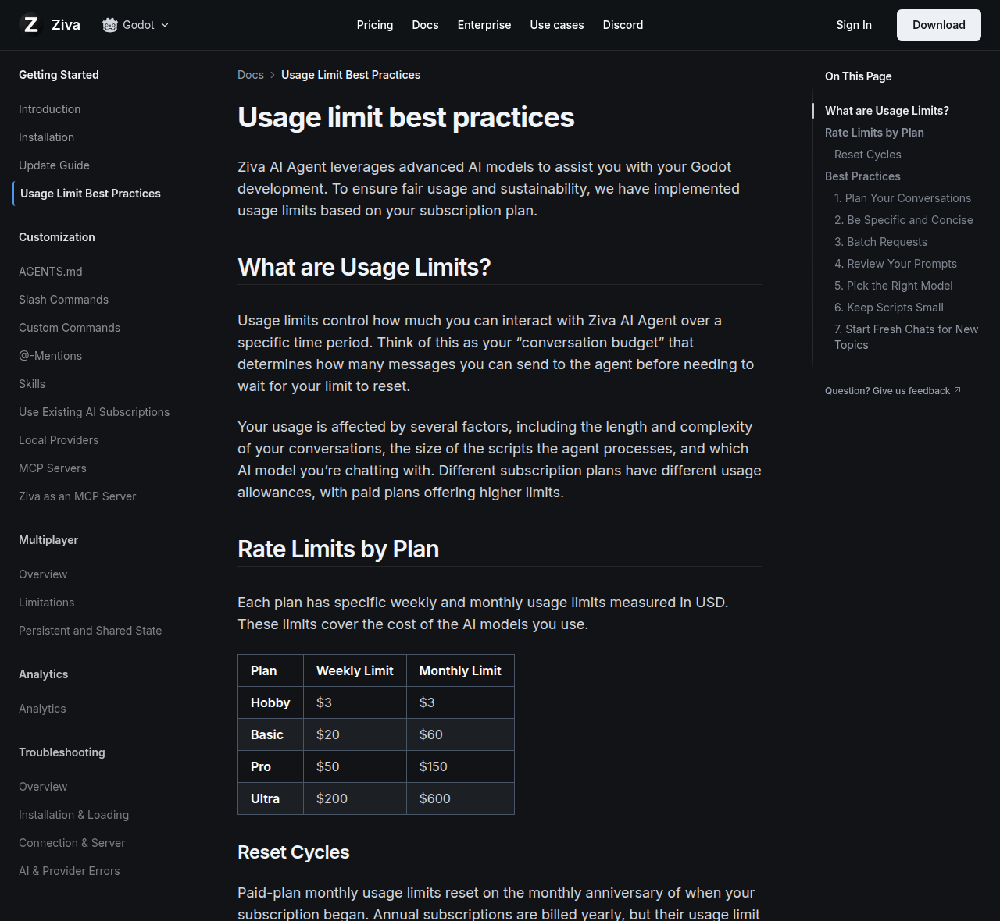
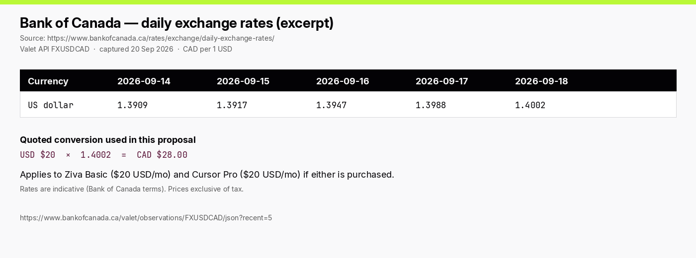

# Event Proposal — 24-Hour AI Game Jam (Godot × paid Ziva)

**Unnatural Intelligence (UI) Club × Game Development Club · Saitsa Student Clubs**
For submission via the Event Proposal Form in the Saitsa Clubs Portal (Portal.HelloRubric.com)

Branded PDF: `event-proposal-24-hour-AI-game-jam.pdf` (regenerate with `python3 Events/24-Hour-AI-Game-Jam/generate_proposal.py`)

Editable deck: `event-proposal-24-hour-AI-game-jam.pptx` (regenerate with `python3 Events/24-Hour-AI-Game-Jam/generate_pptx.py`). Upload to Drive and **Open with Google Slides**, or open in PowerPoint.

Quoted prices: [`quotes/`](quotes/README.md) — **only the attached Curated Catering campus menu cards** for food. No Hotel Arts Event Palette items.

This is the **overnight Saturday–Sunday** variation of the one-day Godot × Ziva jam. Game development is a hard **24 hours**. Doors **Saturday 9:00 AM**. Paid **Ziva Basic** for every attendee. Not a sleepover: jammers may leave overnight and return.

---

## 1. Event overview

| Field | Details |
|---|---|
| Club name | Unnatural Intelligence (UI) — non-academic club |
| Collaborating club | SAIT Game Development Club (also operating as Video Game Design Club) |
| Event type | Educational live-lab / social (on campus, no alcohol) |
| Event title | 24-Hour AI Game Jam |
| Portal title (≤50 characters) | 24-Hour AI Game Jam × Game Dev Club |
| Proposed date | Saturday 14 November – Sunday 15 November 2026 |
| Proposed time | **Sat 9:00 AM – Sun ~1:00 PM** (doors Sat 9:00; official jam **Sat 10:30 – Sun 10:30**; judging then teardown) |
| Venue request | Indoor computer-friendly classroom or lab with projector, power, and Wi-Fi (Stan Grad / Heritage Hall). Weekend + after-hours booking via SECC. Overflow if RSVPs exceed ~40. |
| Target audience | All SAIT students — no prior game-dev or AI experience |
| Expected attendance | **30** (recommended, fully fed) to **50** (ceiling; pizza dinner instead of the $29 buffet). Above 50 blows the $5,000 cap. |
| Engine | **Godot 4** (free, MIT). One engine for the whole room. |
| AI | **Ziva Basic** at **CAD $28 / attendee** (USD $20 × BoC 1.4002). Cursor is **optional BYO**, not bought for the room. |
| Primary Event Organizer (PEO) | VP, Unnatural Intelligence (Pierre Tchio). Game Development Club exec is logistics lead and overnight deputy. |
| Club contact | via SECC: saitsa.clubs@edu.sait.ca |

### Description

A 24-hour on-campus game jam co-hosted by Unnatural Intelligence and the Game Development Club. Doors Saturday 9:00. Theme, teams, Godot, and **Ziva Basic** redeem are done by 10:30. **Official build time is 24 hours** (Saturday 10:30 AM – Sunday 10:30 AM). Teams of 2–5 ship a playable Godot prototype with Ziva inside the editor. Food is five drops from the **attached Curated Catering campus menu**. Mentors float; judging after freeze. No alcohol. Not a sleepover — anyone who stays after facility hours is in a booked room, listed with Campus Security, with a named organizer on site.

Why 24 hours on this menu: the one-day jam is $1,500 on free Ziva Hobby. A full overnight needs **paid Ziva** (Hobby’s $3 usage will not last 24 hours) and four extra food drops. Campus lunch boxes at $16 and breakfast lites at $10–$12 are cheaper than the old Event Palette Working/Continental lines, which is how 30 people still fit under the $5,000 term cap with Ziva Basic.

### Why Godot + paid Ziva (Cursor is optional)

| Choice | Why |
|---|---|
| **Godot 4** | Free, no seat tax, 2D-first, one installer. Right for a jam. |
| **Ziva Basic (paid, primary)** | Lives **inside** Godot. Basic is **$20 USD/mo** with **$20 weekly / $60 monthly** usage ([quote](quotes/ziva-usage-limits.png)). CAD **$28.00** at BoC 1.4002. Hobby ($3) is too small for 24 hours. Any plan can connect Claude Code or Codex so those requests skip Ziva balance. |
| **Cursor (not purchased)** | Same $20 USD as Basic, but a text editor unless bridged over MCP. Buying both is CAD $56/person. BYO or campus credits only. |
| **Not Unity / Layer / Meshy as the primary AI** | Seat taxes or asset generators. This jam’s bottleneck is shipping a Godot scene. |

---

## 2. Agenda (Saturday 9:00 → Sunday afternoon)

**24 hours of game dev is non-negotiable.** Doors at 9:00 (same as the one-day jam) so setup is done before the clock. Freeze is Sunday 10:30.

| Clock | Duration | Segment |
|---|---|---|
| Sat 08:30–09:00 | 30 min | Exec setup (room, power map, Godot USB, Ziva Basic redeem sheet) |
| Sat 09:00–09:15 | 15 min | Doors, attendance, power map, both-club sign-ups |
| Sat 09:15–10:00 | 45 min | Welcome, rules, **secret theme**, team formation (2–5) |
| Sat 09:30 | — | **Continental Lite** drop (kickoff muffins / fruit / yogurt + coffee) |
| Sat 10:00–10:30 | 30 min | Setup lab: Godot 4 + **Ziva Basic**. Nobody starts until both are up. |
| Sat 10:30 | — | **Official start.** 24-hour clock. |
| Sat 12:30–13:30 | 60 min | **Lunch boxes** drop. Eat at desks. |
| Sat 10:30–18:30 | 8 h | Build block 1. Mentors float. Optional mid-jam playtest ~16:00. |
| Sat 18:30–19:30 | 60 min | **Taste of the Philippines** dinner (or pizza if the 50-person ceiling). Eat at desks. |
| Sat 18:30–00:00 | 5.5 h | Evening build. |
| Sun 00:00 | — | **Energy bars & bites** midnight drop. |
| Sun 01:00–06:00 | 5 h | Quiet hours. Leave-and-return allowed. Two-person exec minimum in the room. |
| Sun 08:00–09:00 | 60 min | **Signature Breakfast Lite** drop. Final polish call. |
| Sun 10:30 | — | **Submissions freeze** (24 hours from official start). Godot export + 60-second playable build. |
| Sun 10:30–12:00 | 90 min | Playtests + judging on the UI rubric. |
| Sun 12:00–12:15 | 15 min | Results. Skill-based showcase only (no raffle). |
| Sun 12:15–12:30 | 15 min | Send-home. |
| Sun 12:30–13:00 | 30 min | Exec teardown, room reset, receipts. |

If SECC cannot hold the room past Sunday noon, freeze at 10:00, 45-minute judging, out by 11:30.

---

## 3. Objectives

1. **Ship a playable Godot game in 24 hours** — every team leaves with a running scene or a recorded playthrough.
2. **Use paid Ziva as a Godot teammate, not as the designer** — every attendee redeems Basic; human finish required.
3. **Cross-club recruitment** — both clubs sign people up; beginners pair with people who have shipped.
4. **Foundations in public** — *untapped* (AI inside Godot overnight), *workflow* (a real jam), *human finish* (it still has to play).

---

## 4. Labour split

“We” = both clubs. Equal cash even if headcount is not equal.

| | Unnatural Intelligence | Game Development Club |
|---|---|---|
| Grant / proposal | Files this proposal and grant | Reviews budget; equal cash contribution |
| Logistics | Assists; overnight deputy shifts | **Coordinates** (SECC room, catering, RSVP, door, power, Security list) |
| AI stack | **Runs Ziva Basic** redeem + setup lab | Godot install, template, export |
| Theme | Decides **together** (secret until Sat 9:15) | Decides **together** |
| Guest speakers / judges | 2–5 | 2–5 |
| Judging rubric | **First draft** (below) | Reviews and co-judges |
| Overnight | Named exec on the roster every hour | Named exec on the roster every hour |
| Money | 50% of the approved total | 50% of the approved total |

### Judging rubric — UI draft, Game Dev to review

Score 1–5. Skill-based only (no raffle).

| Criterion | What “5” looks like |
|---|---|
| Playable | A stranger can run it in 60 seconds without an exec at the keyboard |
| Theme | The secret theme is readable in play, not only in the title |
| Godot craft | Scenes/nodes/signals on purpose; not one 2,000-line script |
| AI as tool | Ziva clearly helped; the team can point to what they kept vs threw away |
| Human finish | Scope cut, juiced, playable loop — not a dumped agent transcript |

Tie-break: most delightful 10 seconds of play. Certificates / club arcade, not purchased gifts.

---

## 5. Requested supplies and budgeting

Built-in floor: **$10 posters + $5 misc**. Do not delete. No spend before grant approval. No alcohol, no gifts for members.

**Recommended ask: $4,100 for 30 people (Ziva Basic + five campus-menu drops), split $2,050 / $2,050.**  
**Ceiling: $5,000 for 50 people (Ziva Basic + pizza dinner instead of the $29 buffet), split $2,500 / $2,500.**

A 50-person Philippines dinner ($1,797 loaded) plus Ziva Basic ($1,400) plus the other four drops does **not** fit the $5,000 cap. 50 people eat pizza at dinner.

### 5.1 Catering — attached Curated Catering cards only

On-campus food **must** go through SAIT’s exclusive caterer via the SECC. **Every food line below is on the attached menu cards.** Do not substitute Event Palette Cookie Jar / Working / Continental $22.

- Cards: [`quotes/`](quotes/README.md)
- Portal / order: via SECC · `SAITevents@hotelarts.ca` · 403-210-5774
- **Taxes & service (quoted on the fees card):** all food is **+ 18% service + 5% GST = × 1.239**.
- **Deposits (same card):** 20% at signing, 50% one month prior, remainder two business days after the event — paid only **after grant approval**, through SECC.
- Additional staff $30/hour, 3-hour minimum — **not budgeted** (drop-off, not a plated service).
- 15% statutory-holiday surcharge — **not applied** (14–15 Nov 2026 is not a statutory holiday).
- Minimums: breakfast and cultural buffets **15 guests**; lunch boxes and energy **5 guests**. We are 30 or 50.
- Lunch boxes: 21–50 guests = **2 protein choices**; whole room sandwiches **or** wraps, not mixed. GF bread on request.

| Menu card | Base | Loaded / person | This jam |
|---|---:|---:|---|
| Continental Lite (breakfast card) | $10.00 | $12.39 | **Sat 9:30 kickoff** |
| Signature Breakfast Lite | $12.00 | $14.87 | **Sun 8:00 breakfast** |
| Morning Griddle Lite | $11.00 | $13.63 | Not used (Signature is the hot breakfast) |
| Lunch boxes | $16.00 | $19.82 | **Sat 12:30 lunch** |
| Taste of the Philippines | $29.00 | $35.93 | **Sat 18:30 dinner (30-person rec.)** |
| Taste of Morocco | $30.00 | $37.17 | Dinner swap (~+$37 / 30 people) |
| Pizza (2 slices) | $6.00 | $7.43 | **Sat dinner on the 50-person ceiling** |
| Energy bars & bites (3 pcs) | $6.00 | $7.43 | **Sun 00:00 midnight** |
| Sides & add-ons | $1–$6 | — | **Not used** |

Loaded totals (× 1.239, rounded):

| Drop | 30 people | 50 people |
|---|---:|---:|
| Continental Lite | $372 | $620 |
| Lunch boxes | $595 | $991 |
| Philippines dinner | **$1,078** | $1,797 (does not fit with Ziva at $5k) |
| Pizza dinner | $223 | **$372** |
| Energy bars | $223 | $372 |
| Signature Breakfast Lite | $446 | $743 |
| **Five-drop rec. (Philippines)** | **$2,714** | — |
| **Five-drop ceiling (pizza dinner)** | — | **$3,098** |

### 5.2 Paid Ziva — CAD $28 per attendee

| SKU | Published | CAD @ 1.4002 | This jam |
|---|---|---:|---|
| Ziva Hobby | Free + $3 usage | $0 | Too small for 24 hours |
| **Ziva Basic** | **$20 USD/mo + $20 weekly / $60 monthly usage** | **$28.00** | **Every attendee, one month, then cancel** |
| Ziva Pro | $50 USD/mo + Playtest Agent | $70.01 | Not for every seat (would blow food) |
| Cursor Pro | $20 USD/mo | $28.00 | **Do not buy** |

| Headcount | Ziva Basic @ $28 |
|---:|---:|
| 30 | **$840** |
| 50 | **$1,400** |

Basic’s **$20 weekly usage cap** can bind if everyone hammers premium models for 24 hours. Mitigation: default to Ziva’s free model + any attendee’s own Claude Code / Codex (allowed on Basic). Do not add Cursor on top.

Sources: [`quotes/ziva-usage-limits.png`](quotes/ziva-usage-limits.png), [`quotes/boc-usd-cad.png`](quotes/boc-usd-cad.png).

### 5.3 Other

| Item | Notes | Cost |
|---|---|---|
| Godot 4 | Free | $0 |
| Room + projector | SECC | $0 |
| After-hours security | Placeholder until SECC/Security quote (AD.4.7.1). Unused grant is reclaimed. | $250–$350 |
| Name tags / power strips | Overnight laptop load | $30–$50 / $50–$60 |
| Prizes | Certificates only | $0 |

---

### 5.4 Budget A — $4,100 recommended (30 people, Philippines dinner)

| Item | Details | Estimated cost |
|---|---|---:|
| Posters | Tabloid 11×17, unaltered Saitsa Clubs logo | $10.00 |
| Misc | Tape, markers, unexpected small costs | $5.00 |
| Continental Lite (30) | Sat kickoff @ $10 pp + 18% + GST | $372.00 |
| Lunch boxes (30) | Sat lunch @ $16 pp loaded | $595.00 |
| Taste of the Philippines (30) | Sat dinner @ $29 pp loaded | $1,078.00 |
| Energy bars (30) | Midnight @ $6 pp loaded | $223.00 |
| Signature Breakfast Lite (30) | Sun breakfast @ $12 pp loaded | $446.00 |
| Ziva Basic (30) | CAD $28 / attendee, one month then cancel | $840.00 |
| After-hours security | Placeholder until Security quote | $350.00 |
| Name tags | Printed club templates | $30.00 |
| Power strips | Overnight laptop load | $50.00 |
| First aid + buffer | Overnight kit + dietary / minimums | $101.00 |
| **TOTAL** | | **$4,100.00** |
| **UI share** | 50% | **$2,050.00** |
| **Game Dev share** | 50% | **$2,050.00** |

Morocco instead of Philippines: add **$37** (take it from buffer).

Pizza instead of Philippines (lean 30): food drops **$847**, total about **$3,250** — not recommended as the only Saturday hot meal.

---

### 5.5 Budget B — $5,000 ceiling (50 people, pizza dinner)

| Item | Details | Estimated cost |
|---|---|---:|
| Posters | Tabloid 11×17, unaltered Saitsa Clubs logo | $10.00 |
| Misc | Tape, markers, unexpected small costs | $5.00 |
| Continental Lite (50) | Sat kickoff @ $10 pp loaded | $620.00 |
| Lunch boxes (50) | Sat lunch @ $16 pp loaded | $991.00 |
| Pizza (50) | Sat dinner @ $6 pp loaded (2 slices) | $372.00 |
| Energy bars (50) | Midnight @ $6 pp loaded | $372.00 |
| Signature Breakfast Lite (50) | Sun breakfast @ $12 pp loaded | $743.00 |
| Ziva Basic (50) | CAD $28 / attendee | $1,400.00 |
| After-hours security | Placeholder | $250.00 |
| Name tags | Printed club templates | $50.00 |
| Power strips | Higher laptop load | $60.00 |
| First aid + buffer | Overnight kit + dietary / minimums | $127.00 |
| **TOTAL** | | **$5,000.00** |
| **UI share** | 50% | **$2,500.00** |
| **Game Dev share** | 50% | **$2,500.00** |

Do not go above 50. Do not swap Philippines in at 50 — that dinner line alone is $1,797 loaded.

---

### 5.6 Side-by-side

| | **30 recommended** | 50 ceiling |
|---|---:|---:|
| Catered | **30** | 50 |
| Ziva Basic | **$840** | $1,400 |
| Sat kickoff | Continental Lite | Continental Lite |
| Sat lunch | Lunch boxes $16 | Lunch boxes $16 |
| Sat dinner | **Philippines $29** | **Pizza $6** |
| Midnight | Energy $6 | Energy $6 |
| Sun breakfast | Signature Lite $12 | Signature Lite $12 |
| Security placeholder | $350 | $250 |
| **Total** | **$4,100** | **$5,000** |
| **Each club** | **$2,050** | **$2,500** |

$2,000 cannot do paid Ziva ($840) plus a real overnight meal plan on this menu.

---

## 6. Quoted expenses (attach these)

### Food (attached campus cards)

### AI / FX

---

## 7. Logistics, risk & compliance

- Room booking coordinated exclusively by the SECC. Game Dev logistics lead files through them.
- **Risk: medium.** Indoor, no alcohol, no sport — but **after-hours**, fatigue, food, dense laptops. Written exec shift roster; PEO or deputy always on site.
- After-hours access with SECC and Campus Security (403-284-8530 / campus.security@sait.ca). Occupants staying after facility hours listed for Security. Booked work session, not an unsanctioned sleepover.
- Quiet hours 01:00–06:00. Leave-and-return allowed. No camping furniture unless SECC allows it.
- Food only through Curated Catering via SECC, **using the attached menu cards**. Dietary needs on RSVP. 72-hour Everyday lead.
- A/V from SECC, returned after Sunday teardown (~13:00).
- Attendance list signed (mandatory for grant-funded events).
- Posters: tabloid 11×17, Saitsa Clubs logo unaltered, saitsa.com/Poster-Submission, $10 built-in. Down within 48 hours.
- Disclose the 50/50 sister-club contribution. If classed as a social event, grant funds must already be in the account before the event proposal.
- Target the **5 October 2026** grant intake. Expected attendance of 50 uses the longer planning window.
- No spend before approval. Unused grant (including unspent security) is reclaimed.
- Ziva Basic is **one month of event access**, then cancelled — not a member gift.

## 8. Promotion

- Posters on Saitsa General Poster Boards (approved first).
- Both clubs’ Discord, Instagram, Teams, Rubric RSVP. Cap 50; waitlist after that.
- Clubs Fall Expo (13–14 October 2026) if the jam is after it.
- Pitch: Godot + Ziva Basic, 24 hours, doors Saturday 9:00, meals included, beginners welcome.

## 9. Exec responsibilities

### Setup (Sat 08:30)

- **Game Dev logistics lead** — room access, power map, Godot USB, Security occupancy list.
- **UI PEO (Pierre)** — Ziva Basic redeem sheet, projector.
- **Haely (President, UI)** — signing authority, welcomes both clubs with the Game Dev president.
- **UI VP Finance + Game Dev finance** — catering drops, split receipts against $2,050 / $2,500.

### During

- Door (shifts, both clubs). Attendance + dietary + emergency contact.
- Sat 10:00 lab: UI on Ziva Basic, Game Dev on Godot.
- Floor: UI on agent/account problems, Game Dev on “this will not play.”
- Overnight: two-person minimum (any mix of the two clubs). Hourly headcount. Security number posted.
- Guests (2–5 each): mentors from Sat 10:30, judges from Sun 10:30.

### After

- Teardown by Sunday 13:00. Room reset.
- Receipts before grant close-out or the clubs eat the cost.
- Attendance numbers in the close-out package.
- Thank-you post; optional itch.io/club arcade of Godot exports.

---

## 10. Quote checklist

1. This proposal (PDF) + [`quotes/`](quotes/README.md) (attached menu cards + Ziva/FX).
2. SECC / Curated Catering quote matching the chosen budget’s drops and headcount.
3. SECC / Campus Security after-hours cost (may be $0).
4. Written co-host confirmation from the Game Development Club signing authority (50/50 split, logistics lead, overnight roster).
5. Optional: Cursor Campus credits as a bonus IDE — not required.

---

Primary Event Organizer — VP, Unnatural Intelligence Club (President: Haely)

Co-host / logistics lead — Game Development Club signing authority: ____________________

Signature: ______________________    Date: ______________
