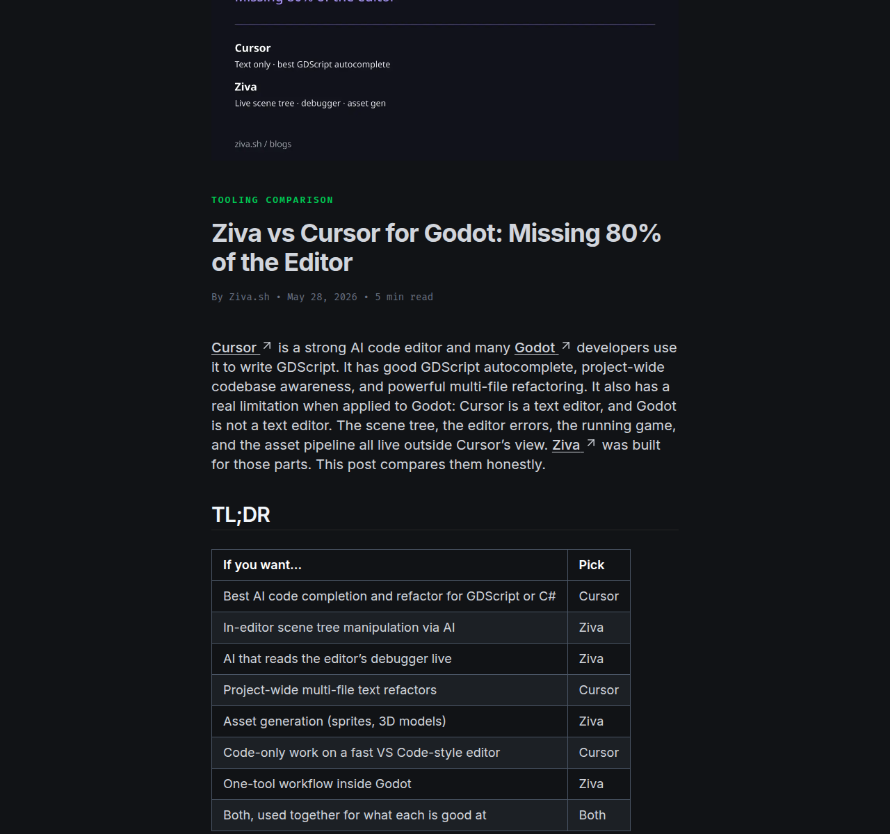
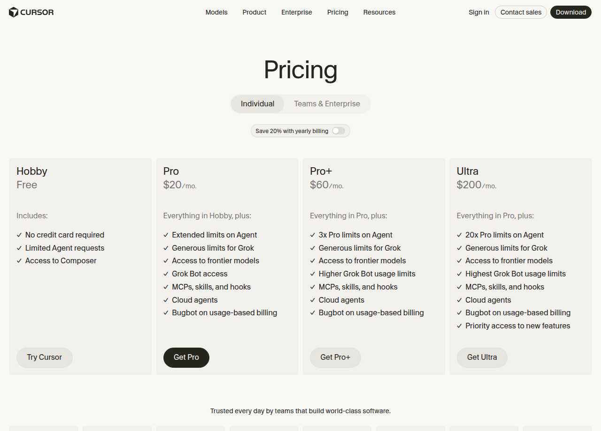
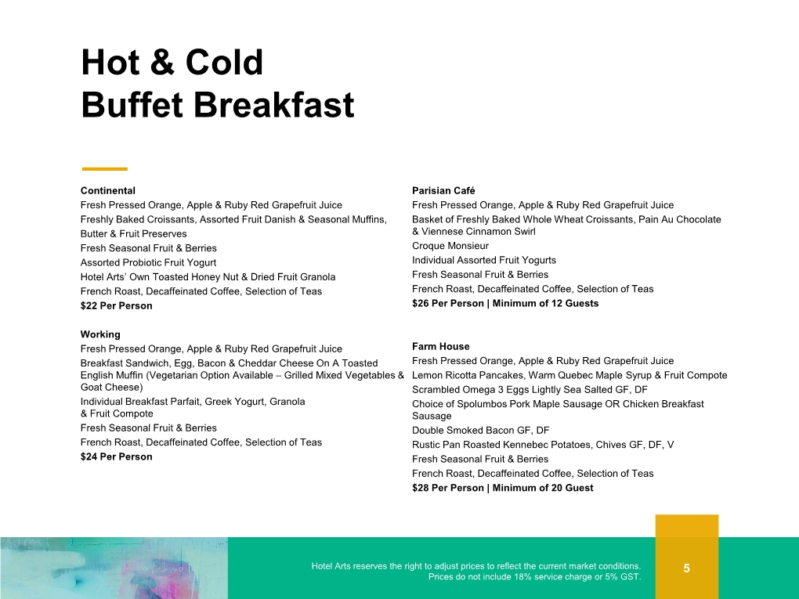
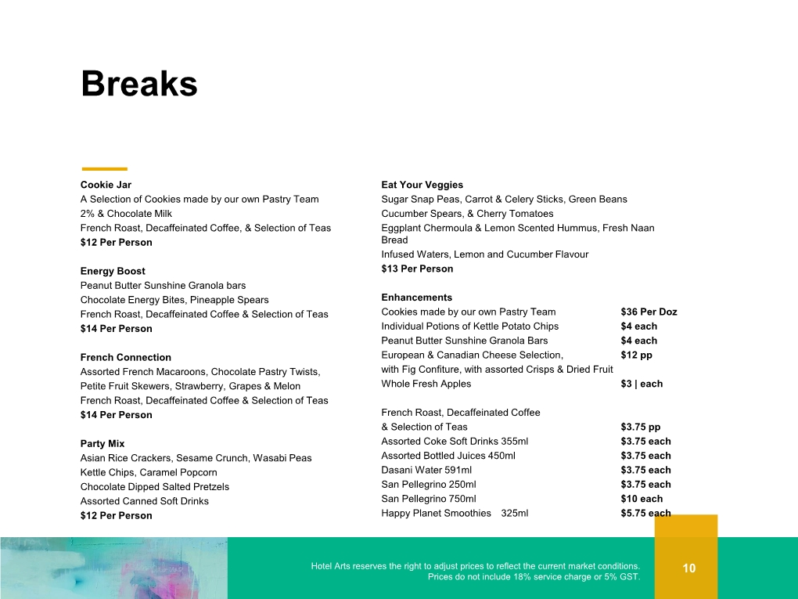
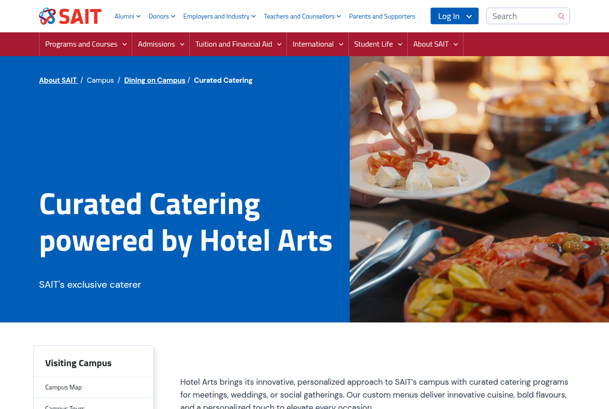
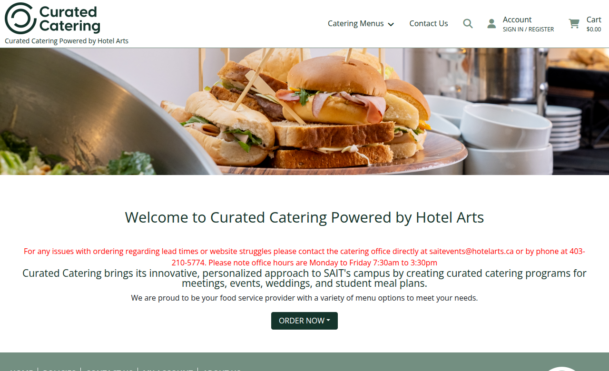

# Event Proposal — One-Day AI Game Jam (Godot × Ziva)

**Unnatural Intelligence (UI) Club × Game Development Club · Saitsa Student Clubs**
For submission via the Event Proposal Form in the Saitsa Clubs Portal (Portal.HelloRubric.com)

Branded PDF: `event-proposal-one-day-AI-game-jam.pdf` (regenerate with `python3 Events/One-Day-AI-Game-Jam/generate_proposal.py`)

Quoted prices (screenshots + links): [`quotes/`](quotes/README.md)

This is the **single-Saturday** version of the collaboration notes (originally a Sat–Sun overnight). Game development is a hard **8 hours**. No overnight, no Sunday breakfast. Doors **9:00 AM**. Mentors float; judging after freeze.

---

## 1. Event overview

| Field | Details |
|---|---|
| Club name | Unnatural Intelligence (UI) — non-academic club |
| Collaborating club | SAIT Game Development Club (also operating as Video Game Design Club) |
| Event type | Educational live-lab / social (on campus, no alcohol) |
| Event title | One-Day AI Game Jam |
| Portal title (≤50 characters) | One-Day AI Game Jam × Game Dev Club |
| Proposed date | Saturday 14 November 2026 |
| Proposed time | **9:00 AM – 8:00 PM** (doors 9:00; official jam 10:30–6:30; results ~7:30; exec teardown to 8:00) |
| Venue request | Indoor computer-friendly classroom or lab with projector, power, and Wi-Fi (Stan Grad / Heritage Hall). Weekend booking via SECC. Overflow if RSVPs exceed ~40. |
| Target audience | All SAIT students — no prior game-dev or AI experience |
| Expected attendance | **30** (core) to **50** (ceiling). Higher than 50 blows catering. |
| Engine | **Godot 4** (free, MIT). One engine for the whole room. |
| AI | **Ziva** inside Godot (Hobby free by default). Cursor is **optional BYO**, not bought for every seat. |
| Primary Event Organizer (PEO) | VP, Unnatural Intelligence (Pierre Tchio). Game Development Club exec is logistics lead. |
| Club contact | via SECC: saitsa.clubs@edu.sait.ca |

### Description

A single-Saturday game jam co-hosted by Unnatural Intelligence and the Game Development Club. Doors at **9:00**. Theme, teams, Godot install, and Ziva setup are done before 10:30. **Official build time is 8 hours** (10:30 AM – 6:30 PM). Teams of 2–5 ship a playable Godot prototype with Ziva as the in-editor agent. Lunch is catered through SAIT’s exclusive vendor. Guest speakers and execs float as mentors; after freeze they judge. Everyone goes home the same evening. No alcohol. No sleepover.

Why a single day: the overnight version needed $3,500–$5,000 mostly for food and security. An 8-hour Saturday starting at 9:00 keeps 30–50 people fed and building, and still clears the room by 8:00 PM.

### Why Godot + Ziva (Cursor is optional, not the grant line)

| Choice | Why |
|---|---|
| **Godot 4** | Free, no seat tax, 2D-first (right for 8 hours), GDScript is readable for beginners, MIT licence, one installer for the whole room. |
| **Ziva (primary)** | Lives **inside** the Godot editor: scene tree, editor errors, running game, sprites. [Hobby is free](https://store.godotengine.org/asset/ziva/ziva/) ($3/mo premium usage + unlimited free model, no credit card). [Basic is $20 USD/mo](https://ziva.sh/docs/usage-limit-best-practices) if we need more usage. Any plan, including Hobby, can connect a student’s existing Claude Code or ChatGPT Codex account so those requests do not burn Ziva balance ([ziva.sh](https://ziva.sh/)). |
| **Cursor (not purchased for the room)** | Strong GDScript autocomplete and multi-file refactors, but it is a **text editor**: it does not see the live scene tree, debugger, or running game unless bridged over MCP. Same **USD $20 / CAD $28** as Ziva Basic. Buying both is **CAD $56 / person**. For an 8-hour Godot jam, spend that money on food, or on Ziva Basic — not on a second IDE. See [Ziva vs Cursor for Godot](https://ziva.sh/blogs/ziva-vs-cursor-for-godot). |
| **When Cursor is worth including** | **BYO** if an attendee already pays for Pro. **Campus event credits** (hi@cursor.com) if they land — then it is a bonus IDE, not a grant line. Mentors who prefer Composer can pair Cursor with Ziva’s local MCP. Do **not** budget 30–50 Cursor seats. |
| **Not Unity / Layer / Meshy as the primary AI** | Unity AI is a seat tax on top. Layer/Meshy generate assets. This jam’s bottleneck is **shipping a Godot scene in 8 hours**. Optional free Kenney/CC0 packs if a team has no artist. |

---

## 2. Agenda (one Saturday)

Compressed from the Sat–Sun notes. **8 hours of game dev is non-negotiable.** Starting at **9:00** (was 10:00) keeps the 8-hour clock and still sends people home by ~8:00 PM, which is easier for SECC than a 9:00 PM close.

| Clock | Duration | Segment |
|---|---|---|
| 08:30–09:00 | 30 min | Exec setup (room, power map, Godot USB, Ziva one-pager) |
| 09:00–09:15 | 15 min | Doors, attendance sheet, power map, member sign-ups (both clubs) |
| 09:15–10:00 | 45 min | Welcome both clubs, rules, **secret theme reveal**, team formation (2–5) |
| 09:30 | — | **Cookie Jar drop** (coffee + pastry) during welcome |
| 10:00–10:30 | 30 min | Setup lab: install **Godot 4**, enable **Ziva Hobby**. Optional: connect existing Claude/Codex, or BYO Cursor. Nobody starts until Godot + Ziva are up. |
| 10:30 | — | **Official start.** Clock starts. |
| 10:30–18:30 | **8 hours** | Build. Mentors (execs + 2–5 guests per club) float. |
| 12:00–12:45 | 45 min | **Optional** combined club-tips talk (not 45–60 min × two clubs — that would eat the jam). People may keep coding. |
| 12:30–13:30 | 60 min | **Catered lunch drop** (Working savoury meal). Eat at desks. |
| ~15:00 | 15–20 min | Optional mid-jam playtest with anyone who wants it (compressed from the notes’ 90-minute Saturday review). Not a hard stop. |
| 18:30 | — | **Submissions freeze** (8 hours from official start). Export Godot project + 60-second playable build or recording. |
| 18:30–19:30 | 60 min | Playtests + judging on the UI-drafted rubric. Short guest remarks if a speaker wants a platform. |
| 19:30–19:45 | 15 min | Results. Skill-based showcase only (no raffle). |
| 19:45–20:00 | 15 min | Send-home. |
| 20:00–20:30 | 30 min | Exec teardown, room reset, receipts. |

If SECC will not hold a classroom past 8:00 PM, this 9:00 start already lands teardown at 20:30. Hard backup: freeze at 18:00, 45-minute judging, out by 19:30.

---

## 3. Objectives

1. **Ship a playable Godot game in 8 hours** — every team leaves with a running scene, even if it is tiny.
2. **Use Ziva as a Godot teammate, not as the designer** — every attendee installs Hobby (or Basic if we upgrade) and ships with a human finish.
3. **Cross-club recruitment** — both clubs sign people up; beginners pair with people who have shipped.
4. **Foundations in public** — *untapped* (AI inside Godot, not a chat tab), *workflow* (a real jam), *human finish* (the game still has to play).

---

## 4. Labour split (from the collaboration notes)

“We” = both clubs. Hours scaled to each exec team’s size so the load is equal even if headcount is not.

| | Unnatural Intelligence | Game Development Club |
|---|---|---|
| Grant / proposal | Files the Saitsa event proposal and grant (this document) | Reviews budget; equal cash contribution |
| Logistics | Assists | **Coordinates** (room with SECC, catering order, RSVP, door, power map) |
| AI stack | **Recommends and runs** Ziva setup lab (Hobby / optional Basic) | Looks after Godot install, project template, export |
| Theme | Decides **together** (secret until 9:15) | Decides **together** |
| Guest speakers / judges | 2–5 | 2–5 |
| Judging rubric | **First draft** (below), then Game Dev reviews | Reviews and co-judges |
| Day-of floor | Ziva / account / model issues | “Will this actually play in Godot?” |
| Money | 50% of the approved total | 50% of the approved total |

### Judging rubric — UI draft, Game Dev to review

Skill-based only (no entry fee + chance + prize). Score 1–5 each:

| Criterion | What “5” looks like |
|---|---|
| Playable | A stranger can run it in 60 seconds without an exec at the keyboard |
| Theme | The secret theme is readable in play, not only in the title |
| Godot craft | Scenes/nodes/signals used on purpose; not one 2,000-line script |
| AI as tool | Ziva clearly helped; the team can point to what they kept vs threw away |
| Human finish | Scope cut, juiced, playable loop — not a dumped agent transcript |

Tie-break: most delightful 10 seconds of play. Certificates / club arcade feature, not purchased gifts (grant cannot cover member gifts).

---

## 5. Requested supplies and budgeting

Built-in floor: **$10 posters + $5 misc**. Do not delete. No spend before grant approval. No alcohol, no gifts for members, swag capped at 50% of ordered cost.

**Recommended ask: $1,500 for 30 people (Ziva Hobby, free AI), split $750 / $750.**  
**Paid-AI option: $2,300 for 30 (Ziva Basic @ CAD $28), split $1,150 / $1,150.**  
**Ceiling: $2,400 for 50 on Hobby, or $3,800 for 50 on Ziva Basic.**

Cursor seats are **not** in any of these totals.

### 5.1 Catering — SAIT menu (Curated Catering powered by Hotel Arts)

On-campus food **must** go through SAIT’s exclusive caterer. Order only via the SECC.

- Portal: [saitcatering.catertrax.com](https://saitcatering.catertrax.com/) — Everyday Catering, 72-hour lead (Express Drop Off is ≤20 people; we are 30–50). Quote image: [`quotes/sait-catertrax.png`](quotes/sait-catertrax.png).
- SAIT page (exclusive caterer): [Curated Catering powered by Hotel Arts](https://www.sait.ca/about-sait/campus/dining-on-campus/curated-catering). Quote image: [`quotes/sait-curated-catering.png`](quotes/sait-curated-catering.png).
- Quote: `SAITevents@hotelarts.ca` · 403-210-5774.
- Prices below are from the **Hotel Arts Event Palette** meeting menu (same caterer as campus). Direct page quotes: [`quotes/hotel-arts-working.png`](quotes/hotel-arts-working.png) (Working **$24 / person**) and [`quotes/hotel-arts-cookie-jar.png`](quotes/hotel-arts-cookie-jar.png) (Cookie Jar **$12 / person**). Footer on those pages: **prices do not include 18% service charge or 5% GST** (× **1.239**). Hotel Arts may adjust to market. Pending a live SECC quote.

| Menu item (Event Palette) | Base | Loaded / person | This jam |
|---|---:|---:|---|
| French roast coffee & tea | $3.75 | $4.65 | Optional extra; Cookie Jar already includes coffee |
| Cookie Jar (pastry + coffee/tea) | $12.00 | $14.87 | **Kickoff drop ~9:30** |
| Party Mix snack | $12.00 | $14.87 | Not used (single day) |
| Energy Boost break | $14.00 | $17.35 | Not used |
| Continental breakfast | $22.00 | $27.26 | Not used (no Sunday) |
| **Working (sandwich + fruit + coffee)** | **$24.00** | **$29.74** | **Saturday lunch** — closest published savoury meal on the Palette. Confirm campus Everyday sandwich lunch with SECC. |
| Wedding plated dinner | $45–$67 | $56–$83 | Not used |

Loaded lunch: **$892 / 30 people**, **$1,487 / 50 people**.  
Loaded Cookie Jar: **$446 / 30**, **$743 / 50**.

### 5.2 Ziva vs Cursor — what we buy

| SKU | Published price | CAD @ BoC 1.4002 (18 Sep 2026) | This jam |
|---|---|---:|---|
| **Ziva Hobby** | Free + $3 USD/mo usage, unlimited free model | **$0** | **Default for every attendee** |
| **Ziva Basic** | $20 USD/mo + $60 usage | **$28.00** | Optional upgrade if Hobby is too tight for 8 hours |
| Ziva Pro | $50 USD/mo + Playtest Agent | $70.01 | Not needed for a jam |
| **Cursor Pro** | $20 USD/mo | **$28.00** | **Do not buy 30–50 seats.** BYO / campus credits only |
| Cursor Hobby | Free, limited Agent | $0 | Fine as BYO; not the Godot agent |
| Cursor Teams | $40 USD / user / mo | $56.01 | Do not buy |

Sources: [Ziva usage limits](https://ziva.sh/docs/usage-limit-best-practices) · [Godot Asset Store pricing table](https://store.godotengine.org/asset/ziva/ziva/) · [cursor.com/pricing](https://cursor.com/pricing) · [Bank of Canada FXUSDCAD](https://www.bankofcanada.ca/valet/observations/FXUSDCAD/json?recent=5) (USD $20 × 1.4002 = CAD $28.00). Quote images: [`quotes/ziva-usage-limits.png`](quotes/ziva-usage-limits.png), [`quotes/cursor-pricing.png`](quotes/cursor-pricing.png), [`quotes/boc-usd-cad.png`](quotes/boc-usd-cad.png).

**Hobby vs Basic for an 8-hour jam.** Ziva’s own timed Godot builds cost well under $3 on cheap models (Flappy Bird samples at $0.17–$1.59). Hobby also has daily message caps (50 Baby / 10 Smart) and a free model that some users now call weak. **Recommendation:** ship the grant on Hobby ($0 AI). Before the 5 October intake, execs spend 30 minutes on Hobby; if it cannot ship a tiny Godot scene, bump the ask to Ziva Basic (same CAD $28 the notes had for Cursor, spent on the Godot-native tool). Do not add Cursor on top.

| Headcount | Ziva Hobby | Ziva Basic @ $28 | Cursor Pro @ $28 (not recommended) |
|---:|---:|---:|---:|
| 30 | **$0** | $840 | $840 extra on top of Ziva |
| 50 | **$0** | $1,400 | $1,400 extra on top of Ziva |

If Cursor Campus issues event credits, treat them as optional IDE access. They do not replace Ziva.

### 5.3 Other

| Item | Notes | Cost |
|---|---|---|
| Godot 4 | Free download | $0 |
| Ziva Hobby | Free | $0 |
| Room + projector | SECC | $0 |
| Overnight security | Not a sleepover | $0 |
| Name tags / power strips | Classroom laptop load | $30–$50 / $40–$50 |
| Prizes | Certificates only | $0 |

---

### 5.4 Budget A — $1,500 recommended (30 people, Ziva Hobby)

| Item | Details | Estimated cost |
|---|---|---:|
| Posters | Tabloid 11×17, unaltered Saitsa Clubs logo | $10.00 |
| Misc | Tape, markers, unexpected small costs | $5.00 |
| Working lunch (30) | Hotel Arts Working @ $24 pp + 18% + GST | $892.00 |
| Cookie Jar (30) | Kickoff coffee + pastry @ $12 pp loaded | $446.00 |
| Ziva Hobby (30) | Free in-editor Godot agent | $0.00 |
| Name tags | Printed club templates | $30.00 |
| Power strips | Classroom laptop load | $40.00 |
| Quote buffer | Dietary / minimums | $77.00 |
| **TOTAL** | | **$1,500.00** |
| **UI share** | 50% | **$750.00** |
| **Game Dev share** | 50% | **$750.00** |

Lunch-only alt (drop Cookie Jar): **$1,000** ($500 each). Still feeds 30.

Paid-AI alt (Ziva Basic × 30 @ CAD $28): **$2,300** ($1,150 each) — same total the Cursor notes used, spent on Ziva instead.

---

### 5.5 Budget B — $2,400 ceiling (50 people, Ziva Hobby)

| Item | Details | Estimated cost |
|---|---|---:|
| Posters | Tabloid 11×17, unaltered Saitsa Clubs logo | $10.00 |
| Misc | Tape, markers, unexpected small costs | $5.00 |
| Working lunch (50) | @ $24 pp loaded | $1,487.00 |
| Cookie Jar (50) | Kickoff @ $12 pp loaded | $743.00 |
| Ziva Hobby (50) | Free in-editor Godot agent | $0.00 |
| Name tags | Printed club templates | $50.00 |
| Power strips | Higher laptop load | $50.00 |
| First aid + buffer | Dietary / minimums | $55.00 |
| **TOTAL** | | **$2,400.00** |
| **UI share** | 50% | **$1,200.00** |
| **Game Dev share** | 50% | **$1,200.00** |

Lunch-only alt (drop Cookie Jar): **$1,650** ($825 each).  
Paid-AI alt (Ziva Basic × 50): **$3,800** ($1,900 each). Do not go above 50.

---

### 5.6 Side-by-side

| | 30 lunch-only | **30 Hobby (rec.)** | 30 Basic | 50 lunch-only | **50 Hobby** | 50 Basic |
|---|---:|---:|---:|---:|---:|---:|
| Catered | 30 | **30** | 30 | 50 | **50** | 50 |
| Ziva | Hobby $0 | **Hobby $0** | Basic $840 | Hobby $0 | **Hobby $0** | Basic $1,400 |
| Cursor | — | **—** | — | — | **—** | — |
| Lunch | $892 | **$892** | $892 | $1,487 | **$1,487** | $1,487 |
| Kickoff Cookie Jar | — | **$446** | $446 | — | **$743** | $743 |
| **Total** | $1,000 | **$1,500** | $2,300 | $1,650 | **$2,400** | $3,800 |
| **Each club** | $500 | **$750** | $1,150 | $825 | **$1,200** | $1,900 |

---

## 6. Quoted expenses (attach these)

Full-size files live in [`quotes/`](quotes/README.md) and are printed in the branded PDF.

### AI

*Ziva rate limits — [ziva.sh/docs/usage-limit-best-practices](https://ziva.sh/docs/usage-limit-best-practices), captured 20 Sep 2026. Hobby is the free plan; Basic is the $20 USD/mo paid plan.*

*[Ziva vs Cursor for Godot](https://ziva.sh/blogs/ziva-vs-cursor-for-godot) — scene tree, debugger, and assets are Ziva; ghost-text and multi-file refactors are Cursor. Combined cost is $40 USD/mo. We pick Ziva.*

*[cursor.com/pricing](https://cursor.com/pricing), captured 20 Sep 2026. Pro is USD $20/mo, exclusive of tax. Cited so the grant can see why we are **not** buying 30 seats.*

*[Bank of Canada daily rates](https://www.bankofcanada.ca/rates/exchange/daily-exchange-rates/) / [Valet FXUSDCAD](https://www.bankofcanada.ca/valet/observations/FXUSDCAD/json?recent=5). USD $20 × 1.4002 = CAD $28.00.*

### Catering

*Hotel Arts Event Palette p.5 — Working **$24 / person**. Footer: 18% service + 5% GST not included. [DocsLib copy](https://docslib.org/doc/1480250/hotel-arts-event-palette-calgary-s-boutique-hotel-a-culinary-event-experience).*

*Hotel Arts Event Palette p.10 — Cookie Jar **$12 / person**, coffee **$3.75 / person**.*

*[sait.ca Curated Catering](https://www.sait.ca/about-sait/campus/dining-on-campus/curated-catering) — SAIT’s exclusive caterer.*

*[saitcatering.catertrax.com](https://saitcatering.catertrax.com/) — order portal; `saitevents@hotelarts.ca` · 403-210-5774; Mon–Fri 7:30 AM–3:30 PM.*

---

## 7. Logistics, risk & compliance

- Room booking coordinated exclusively by the SECC — Game Dev Club logistics lead books through them, not directly.
- **Risk: low.** On campus, indoor, Saturday only, no alcohol, no overnight, no sport. Long day + laptops + food still need a PEO on site the whole time.
- Food only through Curated Catering / Hotel Arts via SECC. Dietary needs on RSVP. 72-hour Everyday lead. Guest guarantee typically 3 business days out.
- A/V from SECC, returned after teardown (~20:30).
- Attendance list signed (mandatory for grant-funded events).
- Posters: tabloid 11×17, Saitsa Clubs logo unaltered, saitsa.com/Poster-Submission, $10 built-in. Down within 48 hours. Do not use the official SAIT logo.
- If SECC classifies this as a social event, grant funds must already be in the club account before the event proposal. Disclose the 50/50 sister-club contribution to the SECC.
- Target the **5 October 2026** grant intake for a mid-November Saturday (confirm 2026/27 dates with SECC).
- No spend before approval. Unused grant is reclaimed at close-out.
- Ziva Hobby is free software, not a member gift. If we buy Ziva Basic, it is **one month of event access**, then cancelled.

## 8. Promotion

- Posters on Saitsa General Poster Boards (approved first).
- Both clubs’ Discord, Instagram, Teams, Rubric RSVP. Cap 50; waitlist after that.
- Clubs Fall Expo (13–14 October 2026) if the jam is after it.
- Pitch: Godot + Ziva, 8 hours, doors 9:00, lunch included, beginners welcome.

## 9. Exec responsibilities

### Setup (08:30)

- **Game Dev logistics lead** — room access, power map, Godot USB/offline installer as backup.
- **UI PEO (Pierre)** — Ziva install sheet (Hobby), projector.
- **Haely (President, UI)** — signing authority, welcomes both clubs with the Game Dev president.
- **UI VP Finance + Game Dev finance** — catering drop, split receipts against each club’s share.

### During

- Door (shifts, both clubs). Attendance + dietary + emergency contact.
- 10:00 lab: UI on Ziva, Game Dev on Godot.
- Floor: UI on agent/account problems, Game Dev on “this will not play.”
- Guests (2–5 each): mentors from 10:30, judges from 18:30.

### After

- Teardown by 20:30. Room reset.
- Receipts before grant close-out or the clubs eat the cost.
- Attendance numbers in the close-out package.
- Thank-you post; optional itch.io/club arcade of Godot exports.

---

## 10. Quote checklist

1. This proposal (PDF) + [`quotes/`](quotes/README.md) screenshots.
2. Live SECC / Curated Catering quote: Working × 30 or 50, Cookie Jar × 30 or 50, drop times **9:30** and **12:30**.
3. Written co-host confirmation from the Game Development Club signing authority, including the 50/50 split and logistics lead.
4. Optional: email Cursor Campus (hi@cursor.com) for *bonus* jam credits — not required for the budget.
5. Optional: 30-minute Hobby test before the 5 October intake; bump to Ziva Basic ($2,300 / 30) only if Hobby cannot ship a tiny scene.

---

Primary Event Organizer — VP, Unnatural Intelligence Club (President: Haely)

Co-host / logistics lead — Game Development Club signing authority: ____________________

Signature: ______________________    Date: ______________
